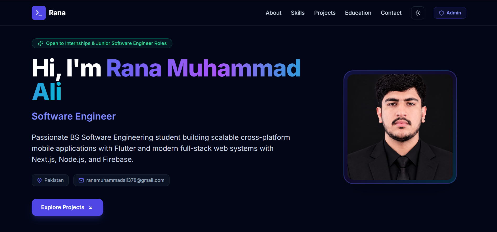
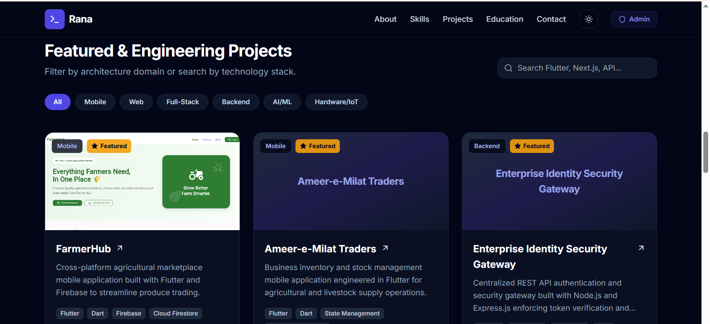
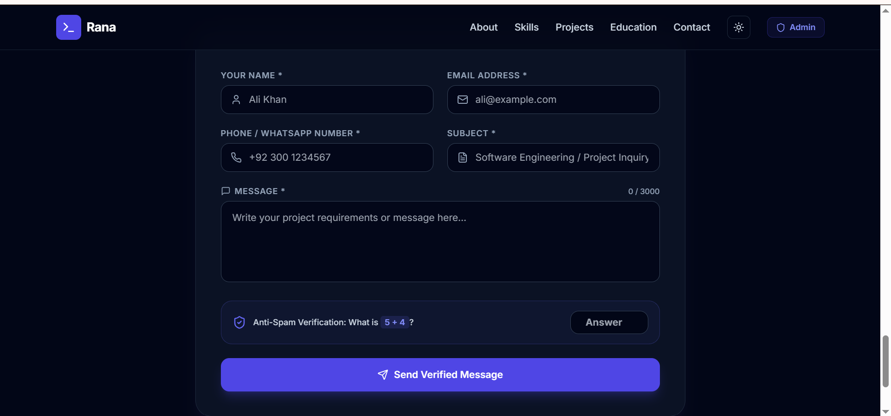
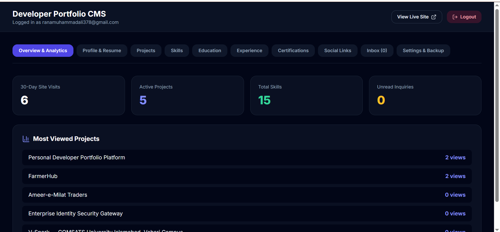
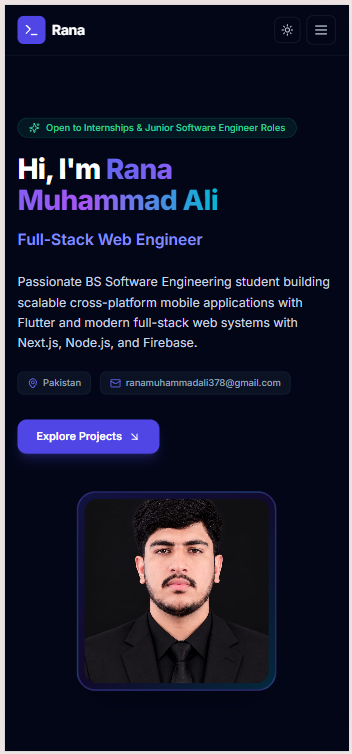

# 🚀 Full-Stack Developer Portfolio & Headless CMS Platform

A secure, production-grade, mobile-first developer portfolio and headless Content Management System (CMS) engineered with **Next.js 14**, **TypeScript**, **Node.js / Express**, and **Firebase (Authentication + Firestore)**.

---

## ✨ Key Architectural & Security Highlights

* **Dynamic Headless CMS (`/admin`):** Manage Hero availability badges, rotating engineering roles, projects (with soft-delete Trash & Restore), skills, education, certifications, social links, and PDF resume uploads in real time.
* **Zero-Trust Security & RBAC:** Firebase ID token verification with custom Admin Role-Based Access Control (`requireAdmin`), strict Zod schema validation, Helmet security headers, CORS allowlisting, and IP-hashed rate limiting.
* **Anti-Spam Contact Pipeline:** Public inquiry form protected by honeypot fields, dynamic math human verification, phone/WhatsApp capture, and instant one-click WhatsApp reply links inside the Admin Inbox.
* **Disaster Recovery & Audit Trail:** One-click full JSON portfolio snapshot export/restore alongside immutable Admin Activity Logs (`UPDATE`, `UPLOAD`, `SOFT_DELETE`, `RESTORE`, `PERMANENT_DELETE`).
* **Automated Jest Security & Validation Suite:** Verified integration tests covering unauthorized access blocking, honeypot rejection, and schema sanitization.

---

## 📸 Platform Preview

### 1. Public Portfolio (Hero & Dynamic Socials)


### 2. Featured Projects & Technical Stack


### 3. Verified Contact Form & Responsive Footer


### 4. Admin CMS — Overview & Real-Time Analytics


### 5. Mobile-First Responsive Layout


---

## 🛠️ Tech Stack

| Layer | Technologies |
| :--- | :--- |
| **Frontend** | Next.js 14 (App Router), React, TypeScript, Tailwind CSS, Framer Motion, Lucide Icons |
| **Backend API** | Node.js, Express, TypeScript, Zod Validation, Express Rate Limit, Helmet, Pino Logger |
| **Database & Auth** | Firebase Admin SDK, Cloud Firestore, Firebase Authentication |
| **Testing & Tooling** | Jest, Supertest, npm Workspaces Monorepo |

---

## ⚙️ Local Setup & Execution

1. **Install Dependencies:**
   ```bash
   npm install